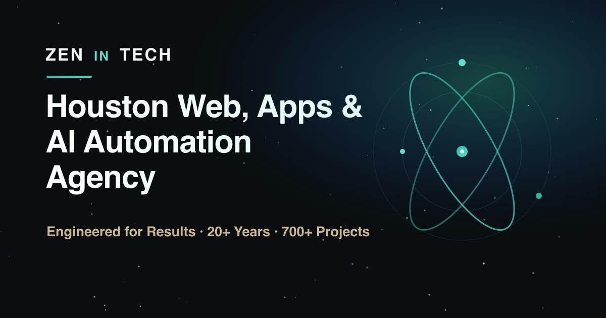

  

# Zen in Tech

An AI-first digital agency based in Houston, Texas. We build websites, web and mobile apps, and the AI automation behind them, for clients in Houston, across the US and worldwide. 20+ years, 700+ projects delivered.

## What we do

- **AI automation:** AI agents and assistants, workflow and CRM automation, chatbots and support, voice agents, RAG and knowledge bases, AI consulting.
- **Development:** websites, web applications, mobile apps, ecommerce, SaaS, React and WordPress, website redesigns.
- **Digital marketing:** SEO and local SEO, PPC and Google Ads, social media, content and email marketing, GEO and AEO (getting cited by AI).
- **Support:** maintenance and improvements after launch.

## How we work with clients

- **A portal for every project.** Each client gets a private `<client>-portal` repository. Requests, bug reports, questions and decisions live there. The code is kept in a separate repository.
- **Visible progress.** Every request is an issue with a clear status, and you always know what we need from you.
- **Versioned releases.** Every delivery is a release (`v1.2.0`) with release notes. Clients find them in their portal.
- **Private by default.** Client code is never public. At handover the repositories can be moved to the client's own GitHub organization.

## Contact

- Website: [zenintech.com](https://zenintech.com)
- Start a project: [zenintech.com/start](https://zenintech.com/start/)
- Book a free 30-minute consultation: [calendly.com/hello-zenintech/30min](https://calendly.com/hello-zenintech/30min)
- Office: 9800 Richmond Ave, Houston, TX 77042
- Existing clients: open an issue in your project portal.
- Security issues: see our [security policy](https://github.com/Zen-In-Tech/.github/blob/main/SECURITY.md).
